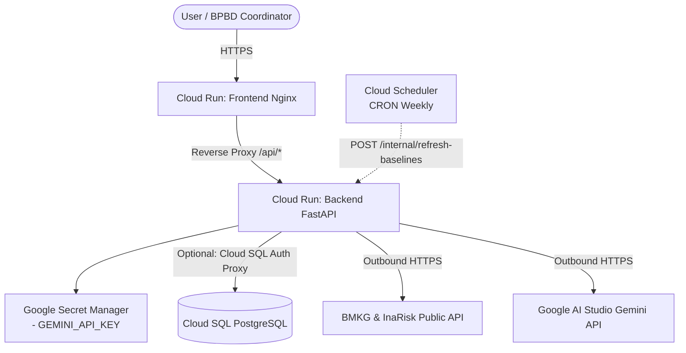

# SIGAP Deployment Guide to Google Cloud Platform (GCP)

This guide describes the architecture and end-to-end steps to deploy the **SIGAP** application's backend (**FastAPI**) and frontend (**React + Vite + Nginx**) to **Google Cloud Run**.

---

## 🏗️ Deployment Architecture



### Why Cloud Run?
1. **Serverless & Scale-to-Zero**: Cost-effective when there is no disaster/traffic, instantly active upon request.
2. **Built-in HTTPS & Custom Domain**: SSL certificates are automatically managed by Google Cloud.
3. **Flexible Port Standard**: Automatically injects the `$PORT` environment variable (default: 8080).

---

## 📋 Prerequisites

1. A Google Cloud account with active billing.
2. [Google Cloud SDK (`gcloud` CLI)](https://cloud.google.com/sdk/docs/install) installed on your local machine.
3. [Docker Desktop](https://www.docker.com/products/docker-desktop/) installed.
4. Gemini API Key from [Google AI Studio](https://aistudio.google.com).

---

## 🚀 Step 1: Initialize gcloud & Enable APIs

Open your terminal and run the initial configuration:

```bash
# 1. Log in to your GCP account
gcloud auth login

# 2. Set your project ID
export GCP_PROJECT_ID="your-project-id"
gcloud config set project $GCP_PROJECT_ID

# 3. Set the default region (asia-southeast2 / Jakarta is recommended for lowest latency)
export GCP_REGION="asia-southeast2"
gcloud config set run/region $GCP_REGION

# 4. Enable required API services
gcloud services enable \
  run.googleapis.com \
  artifactregistry.googleapis.com \
  cloudbuild.googleapis.com \
  secretmanager.googleapis.com
```

---

## 📦 Step 2: Create an Artifact Registry Repository

Artifact Registry is used to store Docker container images for both backend and frontend.

```bash
# Create a Docker repository
gcloud artifacts repositories create sigap-repo \
  --repository-format=docker \
  --location=$GCP_REGION \
  --description="Docker Repository for SIGAP"

# Configure local Docker authentication to Artifact Registry
gcloud auth configure-docker ${GCP_REGION}-docker.pkg.dev
```

---

## 🔑 Step 3: Store Sensitive Credentials in Secret Manager

Do not store API keys in plain-text environment variables or commit them to git. Store them in Google Secret Manager:

```bash
# Store Gemini API Key
echo -n "ENTER_YOUR_GEMINI_API_KEY" | gcloud secrets create sigap-gemini-key \
  --data-file=- \
  --replication-policy="automatic"

# (Optional) Token for Cloud Scheduler baseline auto-refresh
echo -n "create-a-secret-random-token-here" | gcloud secrets create sigap-refresh-token \
  --data-file=- \
  --replication-policy="automatic"

# Database URL (e.g. postgresql://postgres:your_password@/postgres?host=/cloudsql/project-bb622a67-c523-4912-9f6:asia-southeast2:sigap)
echo -n "DB-postgres-connection-string-url" | gcloud secrets create sigap-db-url \
  --data-file=- \
  --replication-policy="automatic"
```

Grant permissions to the Cloud Run Service Account to access these secrets:

```bash
# Get project number
export PROJECT_NUMBER=$(gcloud projects describe $GCP_PROJECT_ID --format='value(projectNumber)')

gcloud projects add-iam-policy-binding YOUR_PROJECT_ID \
  --member="serviceAccount:YOUR_SERVICE_ACCOUNT_EMAIL" \
  --role="roles/cloudsql.client"

# Grant Secret Manager Secret Accessor role to default Compute Engine service account
gcloud secrets add-iam-policy-binding sigap-gemini-key \
  --member="serviceAccount:${PROJECT_NUMBER}-compute@developer.gserviceaccount.com" \
  --role="roles/secretmanager.secretAccessor"

gcloud secrets add-iam-policy-binding sigap-refresh-token \
  --member="serviceAccount:${PROJECT_NUMBER}-compute@developer.gserviceaccount.com" \
  --role="roles/secretmanager.secretAccessor"

gcloud secrets add-iam-policy-binding sigap-db-url \
  --member="serviceAccount:${PROJECT_NUMBER}-compute@developer.gserviceaccount.com" \
  --role="roles/secretmanager.secretAccessor"
```

---

## ⚙️ Step 4: Build & Deploy Backend (FastAPI)

The SIGAP backend uses Python 3.11 with geospatial libraries (`geopandas`, `shapely`, `pyproj`). Allocate at least **2 vCPUs** and **2 GiB RAM** for geospatial processing.

### 4.1 Build Container Image
#### Docker Authentication to GCP Artifact Registry
```bash
gcloud auth configure-docker ${GCP_REGION}-docker.pkg.dev

gcloud auth print-access-token | docker login \
  -u oauth2accesstoken \
  --password-stdin https://${GCP_REGION}-docker.pkg.dev
```

#### Build image locally
```bash
docker build -t ${GCP_REGION}-docker.pkg.dev/${GCP_PROJECT_ID}/sigap-repo/sigap-backend:v1 .
```

#### Push image to Artifact Registry
```bash
docker push ${GCP_REGION}-docker.pkg.dev/${GCP_PROJECT_ID}/sigap-repo/sigap-backend:v1
```

### 4.2 Deploy to Cloud Run

```bash
gcloud run deploy sigap-backend \
  --image ${GCP_REGION}-docker.pkg.dev/${GCP_PROJECT_ID}/sigap-repo/sigap-backend:v1 \
  --platform managed \
  --region $GCP_REGION \
  --allow-unauthenticated \
  --memory 2Gi \
  --cpu 2 \
  --timeout 180 \
  --min-instances 0 \
  --max-instances 10 \
  --set-env-vars="SKIP_DB=false,DEMO_MODE=false,GEMINI_MODEL=gemini-3.5-flash-lite,DEMO_CITY=33.74" \
  --set-secrets="GEMINI_API_KEY=sigap-gemini-key:latest,REFRESH_TOKEN=sigap-refresh-token:latest,DATABASE_URL=sigap-db-url:latest" \
  --add-cloudsql-instances=project-bb622a67-c523-4912-9f6:asia-southeast2:sigap
```

> **Database Mode Note**:
> - `SKIP_DB=true`: Backend runs using built-in JSON cache files (suitable for instant demos without Cloud SQL database costs).
> - If connecting to Cloud SQL Postgres, change `SKIP_DB=false`, set the `DATABASE_URL` environment variable, and add the `--add-cloudsql-instances` flag.

Save the generated backend URL (e.g., `https://sigap-backend-xyz-as.a.run.app`).

---

## 🎨 Step 5: Build & Deploy Frontend (React + Vite + Nginx)

The SIGAP frontend is bundled and served using Nginx Alpine. Nginx is configured to proxy `/api/*` requests directly to the backend URL.

### 5.1 Set Target Backend URL

```bash
export BACKEND_URL=$(gcloud run services describe sigap-backend --platform managed --region $GCP_REGION --format='value(status.url)')
echo "Target Backend URL: $BACKEND_URL"
```

### 5.2 Build Frontend Image

#### Build image locally
```bash
docker build -t ${GCP_REGION}-docker.pkg.dev/${GCP_PROJECT_ID}/sigap-repo/sigap-frontend:v1 .
```

#### Push image to Artifact Registry
```bash
docker push ${GCP_REGION}-docker.pkg.dev/${GCP_PROJECT_ID}/sigap-repo/sigap-frontend:v1
```

### 5.3 Deploy Frontend to Cloud Run

```bash
gcloud run deploy sigap-frontend \
  --image ${GCP_REGION}-docker.pkg.dev/${GCP_PROJECT_ID}/sigap-repo/sigap-frontend:v1 \
  --platform managed \
  --region $GCP_REGION \
  --allow-unauthenticated \
  --memory 512Mi \
  --cpu 1 \
  --min-instances 0 \
  --max-instances 10 \
  --set-env-vars="BACKEND_URL=${BACKEND_URL}"
```

Copy the generated frontend URL (e.g., `https://sigap-frontend-xyz-as.a.run.app`).

---

## ✅ Step 6: Verification & Testing

### 1. Test Backend Health Check
```bash
curl -s $BACKEND_URL/ | jq .
# Expected response:
# {
#   "status": "ok",
#   "timestamp": "2026-...",
#   "version": "0.4.0",
#   "demo_mode": false
# }
```

### 2. Test Swagger API Documentation
Open your browser and navigate to:
```
https://sigap-backend-xyz-as.a.run.app/docs
```

### 3. Access Frontend Dashboard
Open the frontend URL in your browser:
```
https://sigap-frontend-xyz-as.a.run.app
```
All Leaflet maps, vulnerability scoring, BMKG data, and Gemini AI narratives are now live on Google Cloud!

---

## 🔄 Step 7 (Optional): Setup Baseline Auto-Refresh with Cloud Scheduler

InaRisk baselines are cached in the system. To automatically refresh the baseline every week:

```bash
REFRESH_TOKEN_VAL=$(gcloud secrets versions access latest --secret="sigap-refresh-token")

gcloud scheduler jobs create http sigap-refresh-baselines \
  --schedule="0 2 * * 1" \
  --uri="${BACKEND_URL}/internal/refresh-baselines?limit=50&token=${REFRESH_TOKEN_VAL}" \
  --http-method=POST \
  --time-zone="Asia/Jakarta" \
  --description="Refresh InaRisk baseline data every Monday at 02:00 WIB" \
  --location="asia-southeast2"
```

---

## 🛠️ Monitoring & Troubleshooting

### Viewing Cloud Run Logs
```bash
# Real-time backend logs
gcloud run services logs tail sigap-backend --region $GCP_REGION

# Real-time frontend logs
gcloud run services logs tail sigap-frontend --region $GCP_REGION
```

### Code Updates & Re-deployment
If there are code changes:
1. Re-run `docker build` and `docker push` (or `gcloud builds submit`) to create a new image.
2. Re-run `gcloud run deploy --image ...` to deploy the latest revision with zero downtime (*zero downtime deployment*).