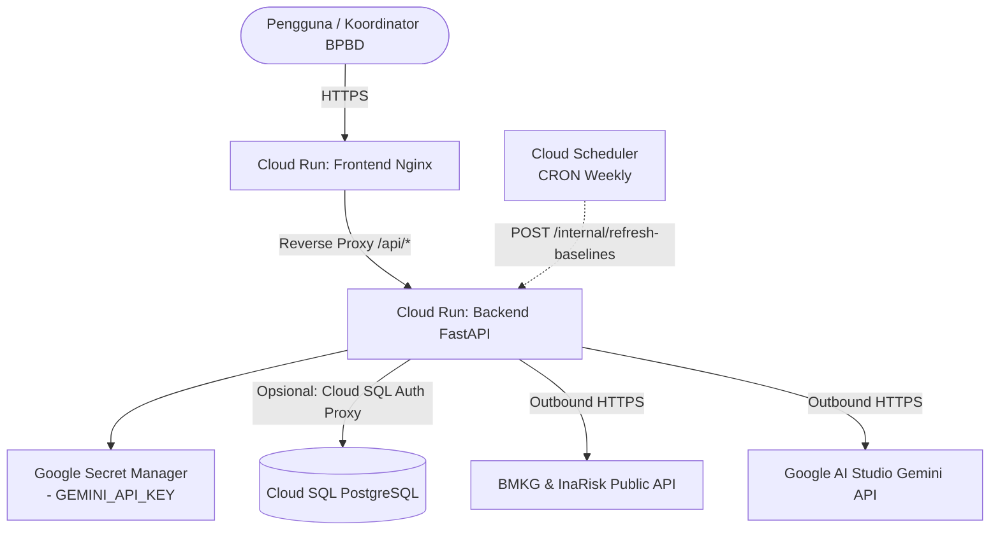

# Panduan Deployment SIGAP ke Google Cloud Platform (GCP)

Panduan ini menjelaskan arsitektur dan langkah-langkah *end-to-end* untuk men-deploy backend (**FastAPI**) dan frontend (**React + Vite + Nginx**) aplikasi **SIGAP** ke **Google Cloud Run**.

---

## 🏗️ Arsitektur Deployment



### Mengapa Cloud Run?
1. **Serverless & Scale-to-Zero**: Hemat biaya saat tidak ada bencana/traffic, instan aktif saat ada request.
2. **Built-in HTTPS & Custom Domain**: Sertifikat SSL otomatis dikelola Google Cloud.
3. **Standar Port Fleksibel**: Otomatis menginjeksi variabel environment `$PORT` (default: 8080).

---

## 📋 Prasyarat (Prerequisites)

1. Akun Google Cloud dengan billing aktif.
2. [Google Cloud SDK (`gcloud` CLI)](https://cloud.google.com/sdk/docs/install) telah terpasang di komputer lokal.
3. [Docker Desktop](https://www.docker.com/products/docker-desktop/) telah terpasang.
4. Gemini API Key dari [Google AI Studio](https://aistudio.google.com).

---

## 🚀 Langkah 1: Inisialisasi gcloud & Aktifkan API

Buka terminal dan jalankan konfigurasi awal:

```bash
# 1. Login ke akun GCP
gcloud auth login

# 2. Tentukan project ID
export GCP_PROJECT_ID="your-project-id"
gcloud config set project $GCP_PROJECT_ID

# 3. Tentukan region default (disarankan asia-southeast2 / Jakarta untuk latensi terendah)
export GCP_REGION="asia-southeast2"
gcloud config set run/region $GCP_REGION

# 4. Aktifkan service API yang dibutuhkan
gcloud services enable \
  run.googleapis.com \
  artifactregistry.googleapis.com \
  cloudbuild.googleapis.com \
  secretmanager.googleapis.com
```

---

## 📦 Langkah 2: Buat Artifact Registry Repository

Artifact Registry digunakan untuk menyimpan image container Docker backend dan frontend.

```bash
# Buat repositori Docker
gcloud artifacts repositories create sigap-repo \
  --repository-format=docker \
  --location=$GCP_REGION \
  --description="Repositori Docker untuk SIGAP"

# Konfigurasikan otentikasi Docker lokal ke Artifact Registry
gcloud auth configure-docker ${GCP_REGION}-docker.pkg.dev
```

---

## 🔑 Langkah 3: Simpan Kredensial Sensitif di Secret Manager

Jangan menyimpan API key di environment plain-text atau commit ke git. Simpan di Google Secret Manager:

```bash
# Simpan Gemini API Key
echo -n "MASUKKAN_GEMINI_API_KEY_ANDA" | gcloud secrets create sigap-gemini-key \
  --data-file=- \
  --replication-policy="automatic"

# (Opsional) Token untuk Cloud Scheduler auto-refresh baseline
echo -n "buat-token-acak-rahasia-disini" | gcloud secrets create sigap-refresh-token \
  --data-file=- \
  --replication-policy="automatic"

# Database URL (e.g. postgresql://postgres:your_password@/postgres?host=/cloudsql/project-bb622a67-c523-4912-9f6:asia-southeast2:sigap)
echo -n "DB-postgres-connection-string-url" | gcloud secrets create sigap-db-url \
  --data-file=- \
  --replication-policy="automatic"
```

Beri izin Cloud Run Service Account untuk membaca secret ini:

```bash
# Dapatkan nomor project
export PROJECT_NUMBER=$(gcloud projects describe $GCP_PROJECT_ID --format='value(projectNumber)')

gcloud projects add-iam-policy-binding YOUR_PROJECT_ID \
  --member="serviceAccount:YOUR_SERVICE_ACCOUNT_EMAIL" \
  --role="roles/cloudsql.client"

# Beri role Secret Manager Secret Accessor ke default Compute Engine service account
gcloud secrets add-iam-policy-binding sigap-gemini-key \
  --member="serviceAccount:${PROJECT_NUMBER}-compute@developer.gserviceaccount.com" \
  --role="roles/secretmanager.secretAccessor"

gcloud secrets add-iam-policy-binding sigap-refresh-token \
  --member="serviceAccount:${PROJECT_NUMBER}-compute@developer.gserviceaccount.com" \
  --role="roles/secretmanager.secretAccessor"

gcloud secrets add-iam-policy-binding sigap-db-url \
  --member="serviceAccount:${PROJECT_NUMBER}-compute@developer.gserviceaccount.com" \
  --role="roles/secretmanager.secretAccessor"
```

---

## ⚙️ Langkah 4: Build & Deploy Backend (FastAPI)

Backend SIGAP menggunakan Python 3.11 dengan pustaka geospasial (`geopandas`, `shapely`, `pyproj`). Alokasikan minimal **2 vCPU** dan **2 GiB RAM** untuk pemrosesan geospasial.

### 4.1 Build Image Container
#### Otentikasi Docker ke GCP Artifact Registry
```bash
gcloud auth configure-docker ${GCP_REGION}-docker.pkg.dev

gcloud auth print-access-token | docker login \
  -u oauth2accesstoken \
  --password-stdin https://${GCP_REGION}-docker.pkg.dev
```

#### Build image secara lokal
```bash
docker build -t ${GCP_REGION}-docker.pkg.dev/${GCP_PROJECT_ID}/sigap-repo/sigap-backend:v1 .
```

#### Push image ke Artifact Registry
```bash
docker push ${GCP_REGION}-docker.pkg.dev/${GCP_PROJECT_ID}/sigap-repo/sigap-backend:v1
```

### 4.2 Deploy ke Cloud Run

```bash
gcloud run deploy sigap-backend \
  --image ${GCP_REGION}-docker.pkg.dev/${GCP_PROJECT_ID}/sigap-repo/sigap-backend:v1 \
  --platform managed \
  --region $GCP_REGION \
  --allow-unauthenticated \
  --memory 2Gi \
  --cpu 2 \
  --timeout 180 \
  --min-instances 0 \
  --max-instances 10 \
  --set-env-vars="SKIP_DB=false,DEMO_MODE=false,GEMINI_MODEL=gemini-3.5-flash-lite,DEMO_CITY=33.74" \
  --set-secrets="GEMINI_API_KEY=sigap-gemini-key:latest,REFRESH_TOKEN=sigap-refresh-token:latest,DATABASE_URL=sigap-db-url:latest" \
  --add-cloudsql-instances=project-bb622a67-c523-4912-9f6:asia-southeast2:sigap
```

> **Catatan Mode Database**:
> - `SKIP_DB=true`: Backend berjalan menggunakan file cache JSON bawaan (cocok untuk demo instan tanpa biaya database Cloud SQL).
> - Jika menghubungkan ke Cloud SQL Postgres, ubah `SKIP_DB=false`, set environment `DATABASE_URL`, dan tambahkan flag `--add-cloudsql-instances`.

Simpan URL backend yang dihasilkan (misal: `https://sigap-backend-xyz-as.a.run.app`).

---

## 🎨 Langkah 5: Build & Deploy Frontend (React + Vite + Nginx)

Frontend SIGAP di-bundle dan disajikan menggunakan Nginx Alpine. Nginx telah dikonfigurasi untuk mem-proxy request `/api/*` langsung ke URL backend.

### 5.1 Tentukan Target Backend URL

```bash
export BACKEND_URL=$(gcloud run services describe sigap-backend --platform managed --region $GCP_REGION --format='value(status.url)')
echo "Target Backend URL: $BACKEND_URL"
```

### 5.2 Build Image Frontend

#### Build image secara lokal
```bash
docker build -t ${GCP_REGION}-docker.pkg.dev/${GCP_PROJECT_ID}/sigap-repo/sigap-frontend:v1 .
```

#### Push image ke Artifact Registry
```bash
docker push ${GCP_REGION}-docker.pkg.dev/${GCP_PROJECT_ID}/sigap-repo/sigap-frontend:v1
```

### 5.3 Deploy Frontend ke Cloud Run

```bash
gcloud run deploy sigap-frontend \
  --image ${GCP_REGION}-docker.pkg.dev/${GCP_PROJECT_ID}/sigap-repo/sigap-frontend:v1 \
  --platform managed \
  --region $GCP_REGION \
  --allow-unauthenticated \
  --memory 512Mi \
  --cpu 1 \
  --min-instances 0 \
  --max-instances 10 \
  --set-env-vars="BACKEND_URL=${BACKEND_URL}"
```

Salin URL frontend yang dihasilkan (misal: `https://sigap-frontend-xyz-as.a.run.app`).

---

## ✅ Langkah 6: Verifikasi & Testing

### 1. Uji Health Check Backend
```bash
curl -s $BACKEND_URL/ | jq .
# Respon yang diharapkan:
# {
#   "status": "ok",
#   "timestamp": "2026-...",
#   "version": "0.4.0",
#   "demo_mode": false
# }
```

### 2. Uji Dokumentasi API Swagger
Buka browser dan akses:
```
https://sigap-backend-xyz-as.a.run.app/docs
```

### 3. Akses Dashboard Frontend
Buka URL frontend di browser:
```
https://sigap-frontend-xyz-as.a.run.app
```
Seluruh peta Leaflet, scoring kerentanan, data BMKG, dan narasi Gemini AI kini aktif di Google Cloud!

---

## 🔄 Langkah 7 (Opsional): Setup Auto-Refresh Baseline dengan Cloud Scheduler

InaRisk baseline di-cache di sistem. Untuk memperbarui baseline setiap minggu secara otomatis:

```bash
REFRESH_TOKEN_VAL=$(gcloud secrets versions access latest --secret="sigap-refresh-token")

gcloud scheduler jobs create http sigap-refresh-baselines \
  --schedule="0 2 * * 1" \
  --uri="${BACKEND_URL}/internal/refresh-baselines?limit=5&token=${REFRESH_TOKEN_VAL}" \
  --http-method=POST \
  --time-zone="Asia/Jakarta" \
  --description="Refresh data baseline InaRisk setiap Senin jam 02:00 WIB"
```

---

## 🛠️ Monitoring & Troubleshooting

### Melihat Logs Cloud Run
```bash
# Log backend real-time
gcloud run services logs tail sigap-backend --region $GCP_REGION

# Log frontend real-time
gcloud run services logs tail sigap-frontend --region $GCP_REGION
```

### Update Kode & Re-deploy
Jika ada perubahan kode:
1. Re-run `gcloud builds submit` untuk membuat image baru.
2. Re-run `gcloud run deploy --image ...` untuk deploy revisi terbaru tanpa downtime (*zero downtime deployment*).
